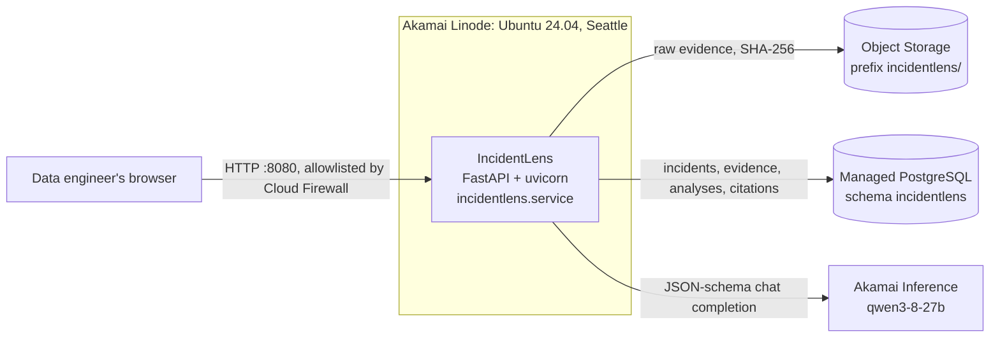

# IncidentLens

**AI-Powered Data Pipeline Forensics.** *See beyond the failure.*

IncidentLens helps data engineers investigate failed pipeline runs. You upload a pipeline log and recent operational change events. IncidentLens rebuilds the incident timeline and proposes root causes, each of which must cite real evidence. When the evidence is not enough to establish a cause, it says so, and it lists what to collect next. Its recovery steps are recommendations that a person must approve. **IncidentLens never executes remediation.**

Built for the Akamai Cloud AI Inference Hackathon (Seattle, November 20, 2026). All data is synthetic.

## User, problem, and benefit

| | |
|---|---|
| **User** | A data engineer or on-call data platform engineer responding to a failed batch pipeline |
| **Problem** | The evidence is scattered. Task logs are in one system, and IAM, deploy, and configuration changes are in others. Rushed investigations blame the most visible change or apply an unsafe fix, such as granting broad access. General-purpose chatbots add a further risk: they give a confident root cause even when the evidence does not support one. |
| **Benefit** | One time-ordered view of logs and changes, with the first failure and the related prior changes highlighted. Hypotheses link to the exact log lines and change events behind them. When the evidence is insufficient, the app says so. Recovery steps are minimal, least-privilege, and recorded for human review. |

## What makes it different: verified, evidence-cited AI

IncidentLens treats the model's answer as a claim to check, not as a final result.

1. **Deterministic ingest.** Each input line gets a stable evidence ID (`LOG-0005` is line 5 of the pipeline log, and `CHG-0002` is line 2 of the change events). The raw files are hashed with SHA-256.
2. **Deterministic signals.** Code finds the timeline, the first failure, and known error signatures (for example `access_denied`). It also finds *linked changes*: changes made before the first failure that share a principal, resource, or permission with a failure message.
3. **Structured model output.** `qwen3-8-27b` returns JSON constrained by a JSON schema: a verdict, ranked hypotheses with cited evidence IDs and short exact quotes, missing evidence, and recovery actions.
4. **Deterministic verifier.** Code checks every model response:
   - It drops citations to evidence IDs that do not exist, and rejects hypotheses that have no valid support.
   - It caps confidence at *low* when a cited change happened after the first failure, or when the change does not touch anything named in the failure.
   - It allows *high* confidence only when a linked change and the failure it links to are both cited.
   - It lowers the verdict to **insufficient evidence** when no hypothesis reaches medium confidence.
   - It sets `requires_human_approval: true` and `executed: false` on every action, and flags broad or destructive wording.
   - It **can lower confidence, but never raise it**. Every adjustment is shown in the UI.
5. **Evidence integrity.** Before every analysis, the app downloads the raw files from Object Storage again and re-checks their hashes. It refuses to analyze evidence that has changed.

## Akamai Cloud services

| Service | Role in IncidentLens | Why it is needed |
|---|---|---|
| **Akamai Inference** (`qwen3-8-27b`) | Produces evidence-cited hypotheses, missing-evidence requests, and recovery recommendations as schema-constrained JSON | The model weighs ambiguous evidence and explains it. The event's chat model supports JSON-schema output and has a 131k-token context. |
| **Linode** (Ubuntu 24.04, Seattle) | Runs the FastAPI app as the systemd service `incidentlens.service` on **port 8080** | The app runs continuously and keeps credentials on the server, never in the browser. It is in the same region as the database. The workshop demo stays untouched on port 80 as a fallback. |
| **Managed PostgreSQL** (schema `incidentlens`) | Stores the case file: incidents, normalized evidence, analyses, model verdicts, verification reports, and citations | A foreign key from `citations` to `evidence` means the database itself rejects a citation to evidence that does not exist. History survives restarts, so saved analyses reopen without another model call. |
| **Object Storage** (private bucket, prefix `incidentlens/`) | Stores the original evidence files unchanged, with SHA-256 hashes in the metadata and the database | Chain of custody: every analysis is traceable to, and re-checked against, the exact uploaded bytes. The bucket stays private. |
| **Cloud Firewall** | Limits SSH and the app ports to allowlisted source IPs | The MVP has no login, so the firewall is the access control. The database has its own allow list as well. |

## Architecture



The request flow is: ingest and hash, then deterministic signals, then the model, then the verifier, then save to PostgreSQL and display. The app is a single process with no queues, workers, or agent framework. A lock allows one analysis at a time, which protects the shared token budget. See [docs/ARCHITECTURE.md](docs/ARCHITECTURE.md) for the schemas, verifier rules, and security model.

## Demo scenarios and observed results

Both scenarios use fictional systems, `example.com` actors, and `*-synth` resources. They are stored in [scenarios/](scenarios/).

### Scenario A: an IAM change comes before authorization errors

The nightly `orders_daily` pipeline fails with repeated `403 AccessDenied` errors for `svc-etl-loader` on `raw-orders-synth`. The change events include a deploy that is a red herring, an IAM change under ticket CR-1042 that removed `storage.objects.get`, a connection-pool change, and a permission change made after the failure.

**Observed:** the verdict was **probable cause**.

- **H1 (high confidence):** the IAM change caused the failure. It cites `CHG-0002`, the first failure `LOG-0005`, and `LOG-0004`. `LOG-0004` shows that listing objects still worked; only reading them failed.
- **Red herrings:** the deploy (`CHG-0001`) and the pool change (`CHG-0003`) were ranked *low*. The post-failure change was marked "after first failure".
- **Verification:** all 7 citations were valid, all 5 quotes matched the stored evidence, and the evidence hashes were re-checked.
- **Recovery:** restore only `storage.objects.get` for `svc-etl-loader` on `raw-orders-synth`, and review the IAM change process. Both actions require approval, and neither was executed.

### Scenario B: insufficient evidence

`inventory_sync` exits with `non-zero status 1` after a heartbeat delay. Its driver log upload failed, so no detailed logs exist. The nearby changes are an unrelated deploy, a schedule change that is tempting but unproven, and a change made after the failure.

**Observed:** both the model's verdict and the final verdict were **insufficient evidence**.

- **Hypotheses:** all three remained *low*, and no citations were invalid.
- **Missing evidence listed:** driver logs for the failed run, `etl-worker-1` CPU, memory, and disk metrics, supplier-feed availability timestamps, and the service's deployment history.
- **Recommended actions:** investigative steps, not a claimed fix. Re-run to check whether the failure is transient, investigate the log-upload failure, and review the schedule change.

## Validation

| Check | Result |
|---|---|
| Offline tests (`uv run pytest`): ingest, signals, verifier, inference parsing, API flows, tamper detection, security headers | **31 passed** |
| Live evaluation, Scenario A (1 run against `qwen3-8-27b`) | **7/7 checks passed**: final verdict, model verdict, no invalid citations, no flagged actions, top hypothesis cites the cause, confidence at least medium, top hypothesis is not a red herring |
| Live evaluation, Scenario B (1 run against `qwen3-8-27b`) | **6/6 checks passed**: final verdict, model verdict, no invalid citations, no flagged actions, confidence capped at low, missing evidence named |
| End to end against the real Akamai services | Both scenarios were stored, hashed, analyzed, verified, and saved. A saved analysis reopened after a restart without a model call |

Each live evaluation was run **once per scenario**, so these results show the system working but do not establish a pass rate. The offline tests include deliberately bad model outputs: fabricated IDs, overconfident claims, and a cause that comes after its effect. They confirm that the verifier rejects or lowers each one.

## Demo walkthrough

1. Open the app. The header badges should show `inference: configured`, `database: connected`, and `object storage: connected`.
2. Click **Scenario A**. The raw files are stored in Object Storage and PostgreSQL, and the timeline appears. Analysis takes about 30–60 seconds.
3. Review the verdict banner, the timeline markers (**first failure**, **linked change**, **after first failure**), and the hypothesis cards. Click any evidence ID to jump to its timeline entry.
4. Review **Recovery checklist** (approval required, not executed), **How we checked the AI**, and **Evidence custody** (object keys and SHA-256 hashes).
5. Click **Scenario B**. The app reports **insufficient evidence**, and **What we don't know** lists what to collect.
6. Open any entry under **Investigation history**. It reloads from PostgreSQL without calling the model.

## Deployment

The app runs on an Akamai Linode as `incidentlens.service` ([deploy/incidentlens.service](deploy/incidentlens.service)) on **port 8080**. The workshop app remains on port 80 as a fallback. The Cloud Firewall admits only allowlisted source IPs, so **the deployed app is reachable only from approved networks**. Judges who cannot connect can review the demo video or run the app locally. The full runbook and rollback steps are in [docs/IMPLEMENTATION_PLAN.md](docs/IMPLEMENTATION_PLAN.md#deployment-runbook-requires-approval).

## Run locally

Requires Python 3.11 and [uv](https://docs.astral.sh/uv/).

```bash
uv sync
cp .env.example .env               # fill in your own values; never commit .env
uv run pytest                      # offline tests, no network
uv run python -m incidentlens      # http://127.0.0.1:8000
uv run python scripts/eval_scenarios.py --runs 1   # live evaluation; spends inference tokens
```

`.env` uses the same variable names as the Akamai workshop: `AKAMAI_BASE_URL`, `AKAMAI_API_KEY`, `CHAT_MODEL`, `PG*`, and `OBJ_*`. The app creates the `incidentlens` schema on first use and writes objects only under the `incidentlens/` prefix.

## Known limitations

- **No authentication.** Access control comes from the Cloud Firewall allowlist, and the app uses synthetic data only.
- **Small live evaluation.** Only one live run per scenario. Model output can vary from run to run.
- **The verifier checks evidence structure, not reasoning.** A wrong hypothesis that cites a real failure with an error signature can still reach *medium*.
- **Slow analysis.** Analysis is synchronous and takes about 30–60 seconds, and only one analysis runs at a time.
- **Limited input.** JSON Lines only, with one pipeline log and one change file per incident.
- **Not yet built:** recording approve or reject decisions, shareable reports, and plain-text log parsing.
- **Possible leftovers on errors.** Raw files are stored before the database write. If the database write fails or is interrupted, stored objects or a partly saved incident can remain.
- **Simple hosting.** The service runs as root, mirroring the workshop setup.

## Acknowledgments

IncidentLens builds on patterns from the Akamai workshop starter, [akamai-developers/akamai-workshop-seattle-hackathon](https://github.com/akamai-developers/akamai-workshop-seattle-hackathon). Those patterns cover the OpenAI-compatible inference client, `psycopg` connections, the `boto3` configuration for Akamai Object Storage, `/health` status reporting, and the systemd service layout. The IncidentLens application, scenarios, verifier, and interface are original work for this hackathon.

More detail: [docs/PROJECT_BRIEF.md](docs/PROJECT_BRIEF.md), [docs/ARCHITECTURE.md](docs/ARCHITECTURE.md), and [docs/IMPLEMENTATION_PLAN.md](docs/IMPLEMENTATION_PLAN.md).
